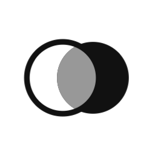

# 临色 · Linse



原生照片调色 App：导入原图与目标风格，匹配颜色，并继续调整、添加蒙版和导出。

本仓库是唯一维护的产品工程，面向 **Apple 芯片（M 系列）的 Mac，macOS 14+** 和 **iPhone / iPad（iOS 17+）**。两端共用 Swift / SwiftUI 与 Metal 实现；旧 TypeScript / Electron App 已退役。

Mac 版可从 [Mac App Store（中国大陆）](https://apps.apple.com/cn/app/id6824873396?mt=12)或 [GitHub Releases](https://github.com/deernova-studio/linse/releases) 下载。iPhone / iPad 版可通过 Xcode 构建。

## 图片与 RAW 导入

普通图片通过系统图像解码导入；相机 RAW 使用专门的 RAW 解码流程，保留完整尺寸与高精度编辑输入。RAW 解码失败时不会静默使用内嵌小预览，会说明原因并保留已有照片和编辑。iPhone / iPad 可以从相册或“文件”选择图片；需要确定使用 RAW 原始文件时，选择“从文件选择（含 RAW）”。

实际兼容范围取决于设备系统支持的相机型号和压缩方式，不能将支持某种扩展名等同于所有机型都兼容。独立回归样片覆盖 DNG / Apple ProRAW、CR2、CR3、NEF、ARW、RAF、ORF、RW2；来源、下载校验与测试方式见 [RAW 测试矩阵](Fixtures/RAW/README.md)。目前未提供 RAW 专用显影参数面板。

## 工程结构

| 目录 | 职责 |
| --- | --- |
| `Sources/LinseCore` | 调色渲染、匹配、蒙版、资源与导出 |
| `Sources/LinseUI` | 共享界面与编辑状态，以及两端的界面适配 |
| `Sources/LinseMac` | macOS App 入口 |
| `macOS/Linse.xcodeproj` | 启用沙盒的 Mac App Store 工程，引用同一入口与共享 Swift 包 |
| `iOS/Linse.xcodeproj` | iPhone / iPad App 工程，引用本地 Swift 包 |
| `scripts/smoke` | 无测试框架的关键流程冒烟入口 |
| `Fixtures` | 保留来源记录的历史参考数据与 RAW 样片清单 |

## 编辑现场与匹配强度

导入的原图、参考图、当前调整、匹配强度、智能蒙版和撤销 / 重做历史会自动保存在本机，下一次启动时恢复。原始图片数据会复制到应用数据目录的 `workspace` 中，原文件移动后仍可恢复，RAW 不会转存成低精度预览。换图后会回收不再使用的图片副本。Mac 退出和 iOS 转入后台时会尝试立即保存；突然断电或系统强制结束仍可能丢失最后尚未写入的改动。

这是单个编辑现场的本机恢复，不是可分享的项目文件；LUT 仍由本机 LUT 库提供，不包含 API Key。恢复损坏时会保留原文件并暂停自动覆盖，可在提示中选择“备份原现场并继续”；备份位于同级 `workspace-backup-*` 目录。

匹配或套用预设后，手动修改参数不会隐藏匹配强度。强度只调整尚未手动修改的参数；手动设定的值、曲线和蒙版保持不变。重新匹配、套用预设或全部复位会开始新的调整；撤销 / 重做同时恢复这套状态。

## macOS 开发与运行

用 Xcode 打开 `Package.swift`，选择 `LinseMac` → `My Mac`，运行即可。也可以在仓库目录执行：

```sh
swift run LinseMac
```

构建可直接打开的本机 App：

```sh
bash scripts/package.sh
```

产物为 `build/临色.app`，脚本使用本机临时签名，供本地测试。

`bash scripts/package.sh --dev` 会生成独立的 `build/dev/临色.app`。更新之前关闭对应的开发版窗口，保留其他版本中的编辑；无需生成安装包。

DMG 版的 AI 接口设置与 API Key 一起明文保存到 `~/.linse/config.json`，不再使用钥匙串。商店版改用应用沙盒内的 `Application Support/Linse/config.json`，不读取沙盒外的配置。首次升级时会保留旧版接口设置，需要在 AI 设置里重新填入一次 API Key；保存后，后续启动与更新都会读取这个配置文件。旧钥匙串条目不会自动读取或删除。iPhone / iPad 的存储方式本次不变。

AI 辅助匹配在每次发送照片前显示接收服务并征求同意，只发送去除元数据的缩小预览。设置内可查看隐私说明或清除 API Key；本地计算匹配不需要 AI 服务。

## macOS 正式签名与分发

本机安装有效的 **Developer ID Application** 证书及对应私钥后，构建仅适用于 Apple 芯片（M 系列）的 arm64 应用：

```sh
bash scripts/package.sh --release
```

如果存在多个开发者签名身份，用 `SIGNING_IDENTITY` 指定完整的 `Developer ID Application: ...` 名称。脚本启用强化运行时和安全时间戳，在 `build/release-candidates` 下生成候选应用及已签名 ZIP；此时尚未公证，不是最终对外分发包。

首次公证需将账号授权保存到系统钥匙串。使用 Apple 账号的 App 专用密码，在命令提示时输入，不要写进脚本或提交到仓库：

```sh
xcrun notarytool store-credentials linse-notary \
  --apple-id '<Apple 账号>' --team-id '<Team ID>'
```

再对候选应用执行公证和 DMG 制作（路径中的版本与构建号以实际产物为准）：

```sh
NOTARY_PROFILE=linse-notary bash scripts/notarize.sh \
  'build/release-candidates/Linse-0.2.10-build12/临色.app'
```

脚本先公证应用并附上票据，再生成带“应用程序”快捷入口的 DMG，对 DMG 签名、公证并验证。成功后 `build/releases` 中的 DMG 才是可对外分发的版本，同时生成 SHA-256 校验文件。日志与提交 ID 保存在候选应用旁的 `notarization` 目录，中断后可重新运行继续等待原申请。应用内容改变后应更新版本号重新构建。

指定新版本与构建号时，在打包命令前设置 `LINSE_VERSION` 和 `LINSE_BUILD_NUMBER`，例如：

```sh
LINSE_VERSION=0.2.11 LINSE_BUILD_NUMBER=13 bash scripts/package.sh --release
```

## GitHub 手动打包与发布

GitHub Actions 仅用于手动发布，普通推送和 PR 不触发检查或构建。在 [Actions → 发布 macOS 版本](https://github.com/deernova-studio/linse/actions/workflows/release.yml) 点击 **Run workflow**，填写新版本号和构建号，流程会执行构建与可运行的冒烟、签名、公证和 DMG 校验，再发布到 GitHub Releases。

首次云端发布需要配置签名证书及公证授权，具体步骤、检查范围和失败恢复见 [GitHub Actions 使用说明](docs/github-actions.md)。

## Mac App Store

首次商店版本免费、无内购。用 Xcode 打开 `macOS/Linse.xcodeproj` 可运行沙盒版；`bash scripts/app-store.sh build` 可进行本机临时签名测试。商店归档、专用证书、手动上传流程及审核资料见 [Mac App Store 说明](docs/app-store.md)。上传 Apple 后台不会自动提交审核或上架。

## 移动端开发与运行

用 Xcode 打开 `iOS/Linse.xcodeproj`，选择 `Linse` 目标，以及 iPhone / iPad 模拟器或真机。运行模拟器需要安装对应运行环境；真机需要配置签名。

仅检查共享代码能否面向 iOS 编译，不需要启动模拟器：

```sh
bash scripts/check-ios.sh
```

这项检查不等同于完整 iOS App 的运行验证。

## 验证与维护

```sh
bash scripts/check-ci.sh
```

修改 `Sources/LinseCore/Shaders.metal` 后，先运行 `python3 scripts/embed-shader.py` 更新内嵌源码，再进行相关验证。

构建和冒烟不依赖 Node.js、Electron 或其他工程目录。`Fixtures/Electron` 仅保留旧版生成的固定颜色参考数据，用来检测原生渲染回归；来源与当前用途见[参考数据说明](Fixtures/README.md)。

本仓库不再维护单元测试、测试 target 或覆盖率门禁。仅保留 [8 条关键冒烟用例](docs/smoke.md)，其中 3 条自动执行、5 条人工验收；未执行项必须明确报告。`docs/plans` 中既有测试记录是历史验证结果，不是当前执行要求。

## 图标与许可

[LinseIcon.svg](Assets/LinseIcon.svg) 是图标源文件。使用 `xcrun swift scripts/render-app-icon.swift` 更新 macOS、iOS 和 DMG 打包使用的图标资源。

项目采用 [MIT 许可证](LICENSE)。文档引用的第三方样片遵循其原始许可。
